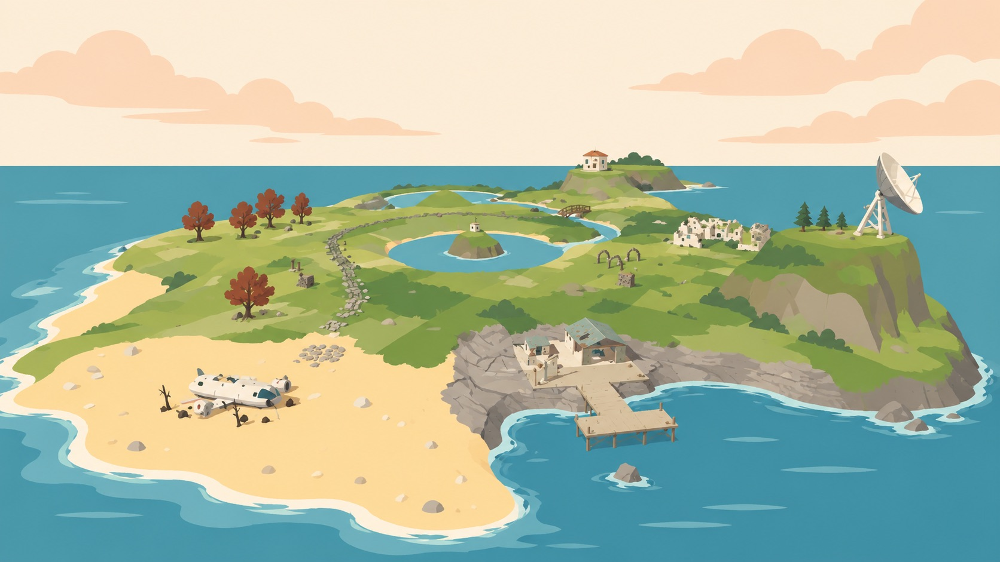

# Rewild · 归野

**One robot, one island, slowly turning green.**

Rewild is a cosy 3D exploration game, made as a game jam project.

You wake up as a small water robot on an island the world forgot. A plane lies broken on the beach, the pier is rusting, the radar is silent and the lake station has gone dark. With a hose, a water tank and plenty of time, you:

- **Rewild the land:** spray away the grime and watch grass, flowers and trees grow back across every region.
- **Restore the island:** reopen the spring, restart the lake power station and wake the sleeping machines that once kept the island running.
- **Gear up:** upgrade your water tank, earn a jetpack and reach corners of the island you couldn't get to before.

The game is available in English and Chinese.

## Download

Website: **https://kaworuikari.github.io/Gamejam21/**

| Platform | Download | Notes |
| --- | --- | --- |
| macOS | [Rewild.dmg](https://github.com/KaworuIkari/Gamejam21/releases/latest/download/Rewild.dmg) | Apple Silicon and Intel, about 880 MB |
| Windows | [Rewild-Windows.zip](https://github.com/KaworuIkari/Gamejam21/releases/latest/download/Rewild-Windows.zip) | Windows 10/11, 64-bit, about 1.4 GB unpacked |

All versions are on the [releases page](https://github.com/KaworuIkari/Gamejam21/releases).

### First launch

**macOS:** open the .dmg and drag Rewild into Applications. The build is not notarized, so macOS blocks it the first time. Click **Done**, then go to System Settings → Privacy & Security, scroll down and click **Open Anyway** next to Rewild.

**Windows:** unzip the whole folder and run `rewild.exe`. Keep the `.dll` files next to the exe. If SmartScreen appears, click **More info** → **Run anyway**.

## For developers

The game is a Godot 4.7 project in [`rewild/`](rewild/): open `rewild/project.godot` in the Godot editor. The website lives in [`website/`](website/) and deploys to GitHub Pages automatically when it changes. Read the [Git workflow](docs/git-workflow.md) before your first commit.

## Credits

Made by Lvgner, KaworuIkari and AntidusPig.

Special thanks to T.K., Arctic Fox, NMR_F4, bill and linhan.
